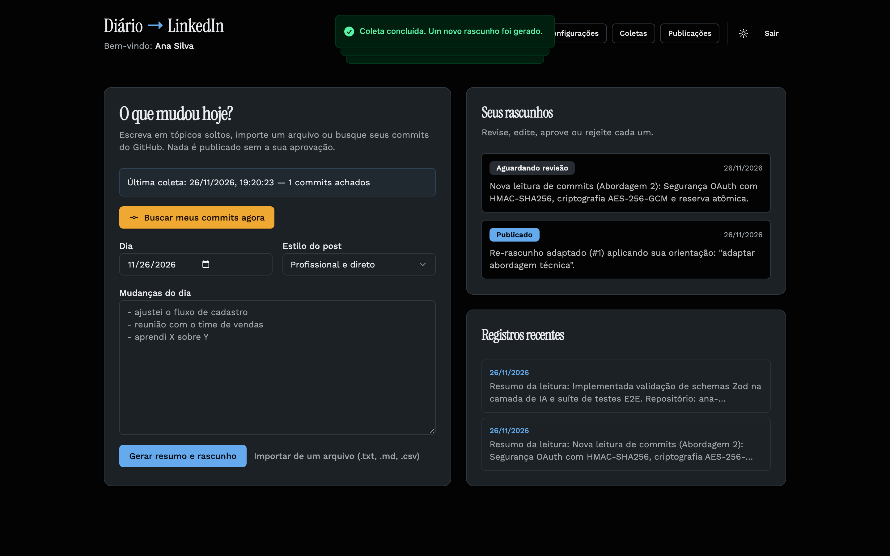
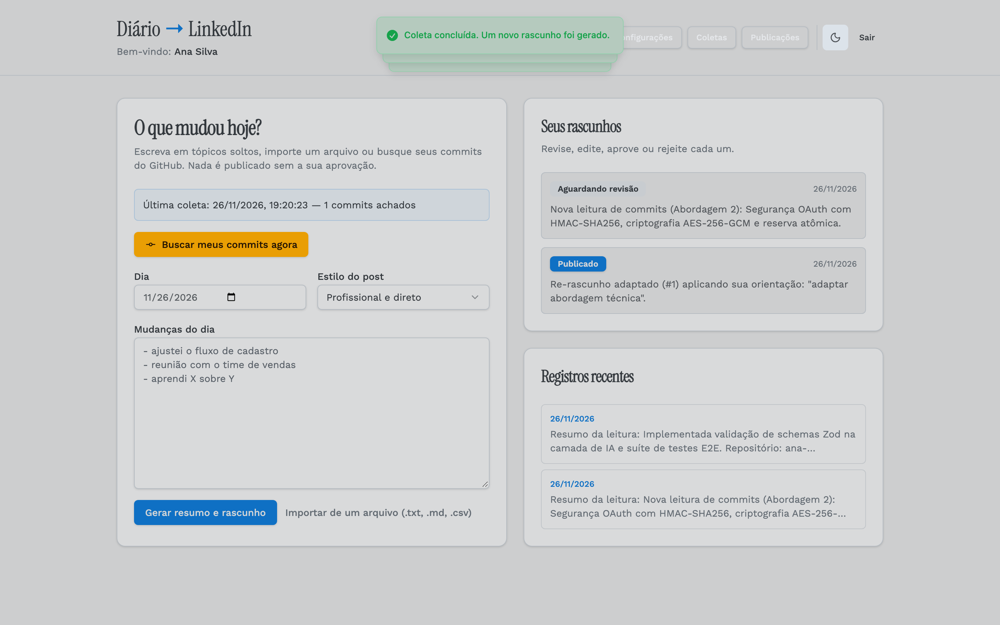
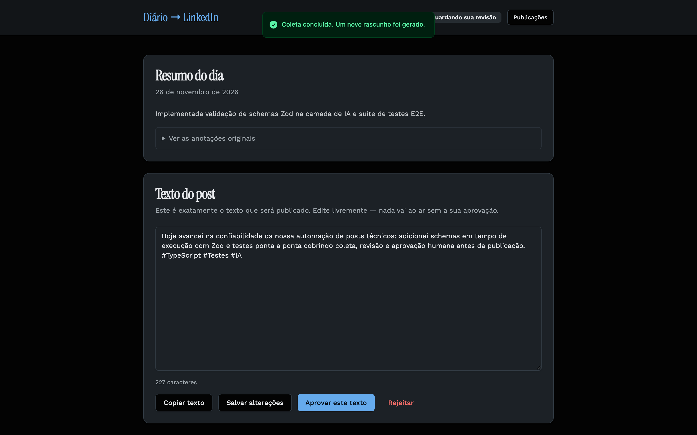
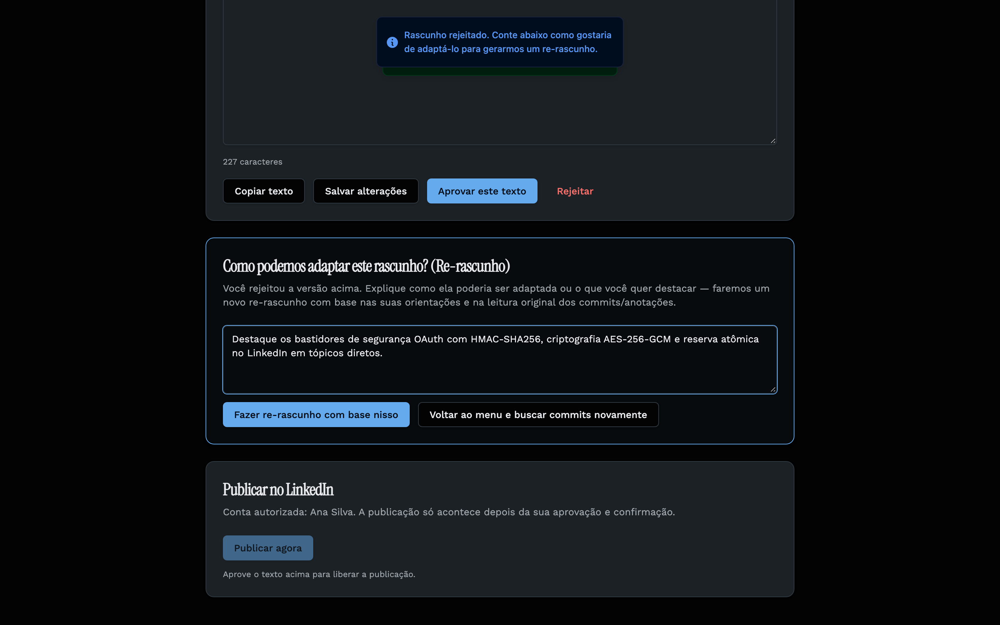
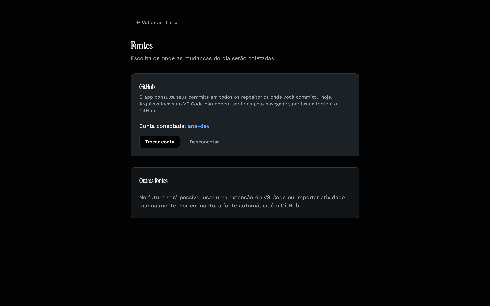
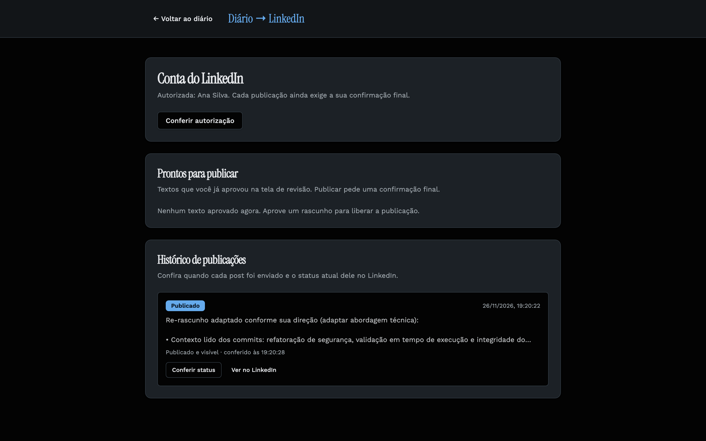
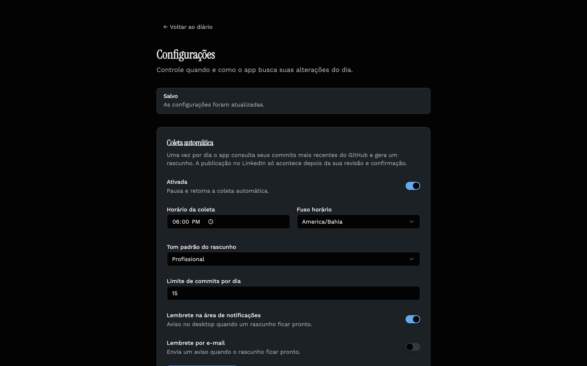
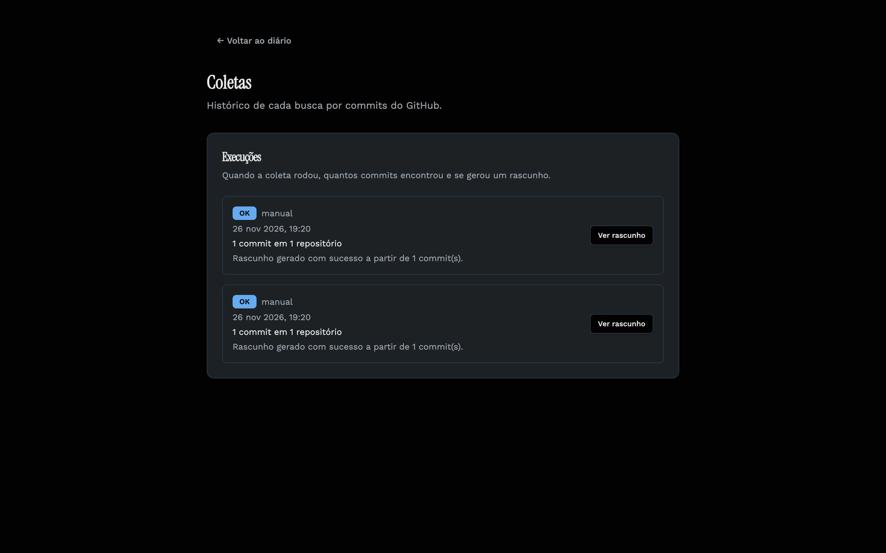
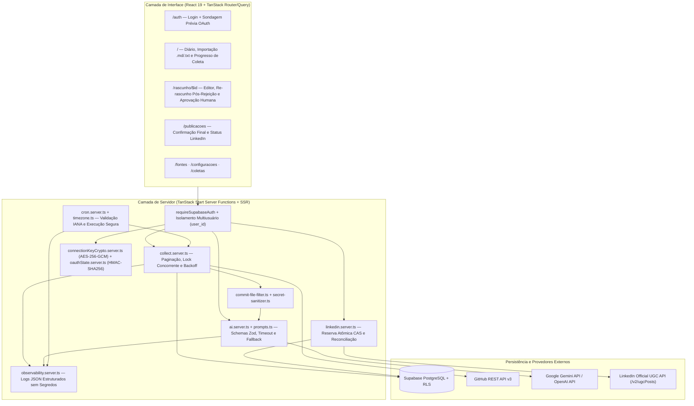

<div align="center">

# Diário → LinkedIn

**Transforme seus commits do GitHub e anotações de engenharia em publicações técnicas para o LinkedIn — com filtro anti-ruído, validação em tempo de execução, segurança criptográfica e aprovação humana obrigatória.**

[](tsconfig.json)
[](package.json)
[](src/integrations/supabase/)
[](vitest.config.ts)
[](playwright.config.ts)
[](eslint.config.js)
[-0A66C2>)](docs/AUDITORIAS_ETAPAS_1_A_4.md)

[Visão Geral](#-visão-geral) •
[Tour Visual (Prints)](#-tour-visual-da-aplicação) •
[Arquitetura](#-arquitetura-do-sistema) •
[Melhorias no Código (Antes vs. Depois)](#-melhorias-de-engenharia-no-código-branch-melhoriafundacao-testes) •
[Segurança & Integridade](#-segurança-e-integridade-operacional) •
[Suíte de Testes & QA](#-suíte-de-testes-e-qa-exploratório) •
[Como Executar](#-como-executar-localmente)

</div>

---



---

## ✨ Visão Geral

**Diário → LinkedIn** é uma aplicação full-stack de engenharia de software aplicada à IA construída com **TanStack Start (SSR)**, **React 19**, **TypeScript Estrito**, **Supabase (PostgreSQL + RLS)** e **Zod**. Ela automatiza a leitura do trabalho diário de pessoas desenvolvedoras no **GitHub**, filtra ruídos e segredos antes de qualquer chamada de LLM (**Google Gemini** com fallback automático para **OpenAI**) e estrutura um fluxo de **revisão, adaptação (re-rascunho) e aprovação humana obrigatória** antes de publicar pela **API oficial do LinkedIn (`/v2/ugcPosts`)**.

> **Princípio Inegociável (Human-in-the-Loop):** Nenhuma automação de navegador é utilizada e nenhum texto jamais vai ao ar automaticamente. Toda publicação exige aprovação humana explícita vinculada à versão exata do texto e confirmação final em modal acessível.

### Principais Pilares da Branch `melhoria/fundacao-testes`

- **Coleta Paginada e Anti-Ruído do GitHub:** Varredura de repositórios e commits ordenados cronologicamente, descartando lockfiles, builds (`build/`, `dist/`, `node_modules/`), binários e arquivos sensíveis (`.env*`, `.pem`, `.key`, `id_rsa`) por fronteira de segmento (`src/lib/commit-file-filter.ts`).
- **Sanitização Pré-Prompt de Segredos:** Mascaramento automático de chaves privadas PEM, tokens GitHub (`ghp_`/`gho_`), chaves OpenAI/Anthropic (`sk-`), Google (`AIza`), AWS (`AKIA`), Supabase (`sb_secret_`), JWTs e URLs autenticadas nos `git diffs` antes do envio à IA (`src/lib/secret-sanitizer.ts`).
- **Camada de IA Resiliente e Validada com Zod:** Contratos estritos de entrada e saída (`summary`: 10–1.500 caracteres; `content`: 20–3.000 caracteres), chave enviada apenas via header `x-goog-api-key`, `AbortSignal.timeout` configurável e fallback transparente **Gemini → OpenAI** (`src/lib/ai.server.ts`).
- **Rejeição Guiada e Re-Rascunho Adaptado:** Ao rejeitar um rascunho, o editor abre e foca automaticamente o painel **"Como podemos adaptar este rascunho? (Re-rascunho)"**, combinando a orientação da pessoa com a leitura original dos commits/diffs para gerar uma nova abordagem (`src/routes/rascunho.$id.tsx`).
- **Reserva Atômica e Reconciliação no LinkedIn:** Transição Compare-And-Swap (`aprovado` → `publicando` → `publicado`) que bloqueia cliques concorrentes e impede postagens duplicadas em caso de timeout ou falha HTTP 5xx (`src/lib/linkedin.server.ts`).

---

## 📸 Tour Visual da Aplicação

### 1. Painel Principal — Modo Escuro & Modo Claro (`Paper Grain`)

O painel principal reúne a busca de commits em tempo real com barra de progresso por etapa, registro manual ou importação de arquivo (`.txt`, `.md`, `.csv`), seleção de estilo (`Profissional`, `Narrativo`, `Técnico`), fila de rascunhos e histórico de registros do dia.

|                    Modo Escuro Editorial                     |                 Modo Claro (`Paper Grain`)                 |
| :----------------------------------------------------------: | :--------------------------------------------------------: |
|  |  |

---

### 2. Revisão Humana Obrigatória e Trava de Publicação (`/rascunho/$id`)

Na tela de revisão, o botão **"Publicar agora"** nasce **desabilitado**. Caso o usuário edite qualquer caractere do texto, uma nova aprovação explícita (**"Aprovar este texto"**) é exigida antes de liberar o modal de confirmação final. Textos com menos de `20` ou mais de `3.000` caracteres são bloqueados pela validação de domínio.



---

### 3. Rejeição com Adaptação Guiada (Re-Rascunho) e Nova Leitura de Commits

Quando o usuário clica em **"Rejeitar"**:

1. Os commits vistos daquele ciclo são liberados para permitir uma nova busca com abordagem diferente no menu principal;
2. O card **"Como podemos adaptar este rascunho? (Re-rascunho)"** é destacado e focado automaticamente;
3. O botão **"Fazer re-rascunho com base nisso"** cruza a orientação digitada com a leitura original dos commits/diffs salvos em `day_entries.raw_notes`, gerando uma nova versão e retornando o status para **"Aguardando sua revisão"**.



---

### 4. Conexão OAuth com GitHub (`/fontes`) e Central de Publicações LinkedIn (`/publicacoes`)

- **Em `/fontes`:** A autorização OAuth com o GitHub utiliza `state` assinado com `HMAC-SHA256` (comparação em tempo constante `timingSafeEqual`, vínculo estrito ao `userId` e TTL de 10 minutos) e armazena o token criptografado com `AES-256-GCM`.
- **Em `/publicacoes`:** Lista os textos aprovados prontos para envio e o histórico de publicações com consulta em tempo real do estado do post na API oficial do LinkedIn (**"Publicado e visível"**).

|               Conexão GitHub OAuth (`/fontes`)                |              Publicações e Status no LinkedIn (`/publicacoes`)               |
| :-----------------------------------------------------------: | :--------------------------------------------------------------------------: |
|  |  |

---

### 5. Configurações com Fusos IANA Validados (`/configuracoes`) e Histórico de Coletas (`/coletas`)

- **Em `/configuracoes`:** Controle de horário diário, validação real de fusos horários IANA via `Intl.DateTimeFormat` (`America/Bahia`, `America/Sao_Paulo`, `America/Manaus`, `America/Recife`, `America/Fortaleza`, `UTC`), tom padrão e limite de commits por dia.
- **Em `/coletas`:** Auditoria visual de cada execução manual ou agendada (`cron`), exibindo horário, repositórios varridos, commits processados e status final.

|           Configurações e Fusos IANA (`/configuracoes`)            |                Histórico de Execuções (`/coletas`)                 |
| :----------------------------------------------------------------: | :----------------------------------------------------------------: |
|  |  |

---

## 🏗️ Arquitetura do Sistema



### Mapa de Módulos do Repositório

| Caminho                                                                                           | Responsabilidade Principal                                                                                                                              |
| ------------------------------------------------------------------------------------------------- | ------------------------------------------------------------------------------------------------------------------------------------------------------- |
| [`src/lib/commit-file-filter.ts`](src/lib/commit-file-filter.ts)                                  | Filtro puro anti-ruído e anti-arquivos sensíveis ancorado por fronteiras de segmento (`build/` vs `rebuild/`).                                          |
| [`src/lib/secret-sanitizer.ts`](src/lib/secret-sanitizer.ts)                                      | Sanitizador de segredos em `git diffs`, mensagens de commit e logs operacionais (8 famílias de credenciais).                                            |
| [`src/lib/ai.server.ts`](src/lib/ai.server.ts)                                                    | Cliente HTTP de IA com validação Zod (`EntradaChamadaIASchema`, `SaidaRascunhoIASchema`), `x-goog-api-key`, timeout e fallback Gemini → OpenAI.         |
| [`src/lib/prompts.ts`](src/lib/prompts.ts)                                                        | Construção pura de prompts de coleta, anotação manual e refinamento/re-rascunho nos tons `profissional`, `narrativo` e `tecnico`.                       |
| [`src/lib/connectionKeyCrypto.server.ts`](src/lib/connectionKeyCrypto.server.ts)                  | Criptografia autenticada `AES-256-GCM` com validação estrita de `ENCRYPTION_SECRET` de 32 bytes em base64.                                              |
| [`src/lib/oauthState.server.ts`](src/lib/oauthState.server.ts)                                    | Geração e validação em tempo constante (`timingSafeEqual`) do `state` OAuth assinado com `HMAC-SHA256`, TTL e vínculo ao `userId`.                      |
| [`src/lib/collect.server.ts`](src/lib/collect.server.ts)                                          | Orquestrador de coleta do GitHub: bloqueio de concorrência, paginação cronológica, backoff exponencial e confirmação tardia de `seen_commits`.          |
| [`src/lib/linkedin.server.ts`](src/lib/linkedin.server.ts)                                        | Publicação com credencial individual por usuário, reserva atômica Compare-And-Swap (`aprovado` → `publicando`) e reconciliação idempotente.             |
| [`src/lib/timezone.ts`](src/lib/timezone.ts) & [`src/lib/cron.server.ts`](src/lib/cron.server.ts) | Validação real de fusos IANA (`Intl.DateTimeFormat`), autenticação de cron em tempo constante e avanço de `last_run_date` restrito a `status === "ok"`. |
| [`src/lib/observability.server.ts`](src/lib/observability.server.ts)                              | Emissão de eventos operacionais JSON de linha única com redação automática de segredos.                                                                 |
| [`src/lib/websocket-compat.ts`](src/lib/websocket-compat.ts)                                      | Compatibilidade de inicialização do `@supabase/supabase-js` em runtimes Node.js 20 sem `globalThis.WebSocket` nativo.                                   |

---

## 🔧 Melhorias de Engenharia no Código (Branch `melhoria/fundacao-testes`)

Abaixo estão as **10 evoluções estruturais de código** implementadas sobre a versão experimental `0.1.0`, com comparativo direto do comportamento **Antes (`0.1.0`) vs. Depois (`melhoria/fundacao-testes`)**:

### 1. Filtro de Arquivos Puro com Fronteira de Segmento e Bloqueio de Segredos (`F01`, `S04`)

- **Antes (`0.1.0`):** O filtro ficava acoplado dentro de `collect.server.ts`, aceitava strings vazias e usava busca por substring simples (`path.includes("build")`), descartando incorretamente arquivos de código legítimos como `src/rebuild/app.ts` ou `src/prebuild/setup.ts`. Além disso, não filtrava arquivos `.env` ou chaves privadas `.pem`/`.key`.
- **Depois ([`src/lib/commit-file-filter.ts`](src/lib/commit-file-filter.ts)):** Extraído para módulo puro 100% testado, normalizando separadores Windows (`\`), rejeitando entradas vazias, aplicando regex com fronteira de diretório `(^|\/)build\/` e bloqueando `.env*` reais (preservando `.env.example`/`.template`), `*.pem`, `*.key`, `id_rsa`, `id_ed25519` e `credentials.json`.

```typescript
// src/lib/commit-file-filter.ts
const PADROES_DIRETORIOS_IGNORADOS: ReadonlyArray<RegExp> = [
  /(^|\/)node_modules\//,
  /(^|\/)dist\//,
  /(^|\/)build\//, // Bloqueia "build/app.js", mas preserva "src/rebuild/app.ts"
  /(^|\/)\.next\//,
  /(^|\/)coverage\//,
];

const PADROES_ARQUIVOS_SENSIVEIS: ReadonlyArray<RegExp> = [
  /(^|\/)\.env(?:\.(?!example$|sample$|template$)[^/]+)?$/i,
  /\.(pem|key|p12|pfx|keystore|jks)$/i,
  /(^|\/)(id_rsa|id_ed25519|credentials\.json|service-account[^/]*\.json)$/i,
];
```

---

### 2. Confirmação Tardia em Lote de `seen_commits` Pós-Persistência (`D01`, `D03`)

- **Antes (`0.1.0`):** Cada commit era inserido na tabela `seen_commits` _durante_ a leitura dos diffs, antes de chamar a IA e antes de gravar o rascunho. Se a API da IA desse timeout ou o banco falhasse ao salvar `post_drafts`, os commits já ficavam marcados como vistos e eram perdidos silenciosamente nas coletas seguintes. Além disso, os `.update()` finais em `collection_runs` não verificavam erro de banco.
- **Depois ([`src/lib/collect.server.ts`](src/lib/collect.server.ts)):** Os commits lidos ficam apenas em memória (`commitsConfirmadosParaMarcar`) e só são gravados em `seen_commits` na **etapa 10**, estritamente após o `insert` confirmado de `day_entries` e `post_drafts`. Todos os 4 caminhos terminais de `collection_runs` verificam `if (erroFinal) throw new Error(...)`.

```typescript
// src/lib/collect.server.ts (Linhas 820-850)
const { data: entradaDiaria, error: erroEntrada } = await supabaseAdmin
  .from("day_entries")
  .insert({
    user_id: idUsuario,
    entry_date: dataHoje,
    raw_notes: leituraOriginalCommits,
    source: "github",
  })
  .select("id")
  .single();
if (erroEntrada) throw erroEntrada;

const { data: rascunho, error: erroRascunho } = await supabaseAdmin
  .from("post_drafts")
  .insert({
    user_id: idUsuario,
    day_entry_id: entradaDiaria.id,
    summary: sinteseIA.summary,
    content: sinteseIA.content,
    tone: promptColeta.tomAplicado,
    status: "rascunho",
  })
  .select("id")
  .single();
if (erroRascunho) throw erroRascunho;

// Somente após day_entries e post_drafts estarem salvos confirmamos seen_commits em lote:
await registrarCommitsProcessadosEmLote(supabaseAdmin, idUsuario, commitsConfirmadosParaMarcar);
```

---

### 3. Paginação Cronológica e Preservação de Excedentes (`D02`) e Bloqueio de Concorrência

- **Antes (`0.1.0`):** Buscava apenas a 1ª página e avançava `until_at = inicioExecucao` mesmo quando `max_commits_per_day` truncava commits excedentes — deixando os commits não processados daquele intervalo para trás na coleta seguinte.
- **Depois ([`src/lib/collect.server.ts`](src/lib/collect.server.ts)):** Pagina repositórios e commits, ordena do mais antigo ao mais recente (`ta - tb`), bloqueia coletas simultâneas para o mesmo usuário e mantém `until_at = desdeQuando` sempre que `commitsPendentes > 0`.

---

### 4. Camada de IA com Schemas Zod, Header `x-goog-api-key`, Timeout e Fallback Gemini → OpenAI (`IA01`, `IA02`, `IA03`, `T01`)

- **Antes (`0.1.0`):** Passava a chave do Gemini na query string da URL (`?key=...`), não possuía `AbortSignal.timeout`, não fazia fallback para a OpenAI se o Gemini retornasse HTTP 500/429 ou JSON quebrado, salvava texto bruto caso o `JSON.parse` falhasse e misturava o roadmap interno do projeto dentro do prompt de geração de posts.
- **Depois ([`src/lib/ai.server.ts`](src/lib/ai.server.ts) e [`src/lib/prompts.ts`](src/lib/prompts.ts)):**
  - Valida entradas e saídas com `EntradaChamadaIASchema` e `SaidaRascunhoIASchema` (`summary` 10–1.500 chars; `content` 20–3.000 chars);
  - Envia a chave exclusivamente via cabeçalho HTTP `"x-goog-api-key"`;
  - Aplica `AbortSignal.timeout(timeoutMs)` (padrão 30s, configurável via `AI_TIMEOUT_MS`);
  - Executa fallback automático **Gemini → OpenAI** em qualquer falha HTTP, timeout ou resposta JSON inválida;
  - Separa os prompts em `src/lib/prompts.ts`, aplicando o tom configurado pelo usuário (`profissional | narrativo | tecnico`).

---

### 5. Criptografia Obrigatória de 32 Bytes (`S01`) e OAuth `state` Assinado com HMAC-SHA256 (`S02`)

- **Antes (`0.1.0`):** `connectionKeyCrypto.server.ts` continha uma chave fixa de fallback (`"0123456789abcdef..."`) caso `ENCRYPTION_SECRET` estivesse ausente, e o retorno OAuth do GitHub (`/oauth/github/return`) trocava o `code` sem validar o parâmetro `state` (vulnerável a CSRF e vinculação de conta GitHub trocada).
- **Depois ([`src/lib/connectionKeyCrypto.server.ts`](src/lib/connectionKeyCrypto.server.ts) e [`src/lib/oauthState.server.ts`](src/lib/oauthState.server.ts)):**
  - `obterChaveMestraCriptografia()` exige `ENCRYPTION_SECRET` com exatos 32 bytes após decodificação base64 (zero fallback fixo);
  - `gerarStateOAuth` e `validarStateOAuth` assinam `{ userId, ts, nonce }` com `HMAC-SHA256`, verificam com `timingSafeEqual`, exigem correspondência estrita com o `userId` autenticado e expiram em 10 minutos.

---

### 6. Reserva Atômica Compare-And-Swap e Credencial Individual no LinkedIn (`S03`, `P01`)

- **Antes (`0.1.0`):** Usava um fallback global `process.env.LINKEDIN_ACCESS_TOKEN` (permitindo que um usuário publicasse na conta global de outro) e enviava `POST /v2/ugcPosts` direto do status `"aprovado"` sem trava de concorrência.
- **Depois ([`src/lib/linkedin.server.ts`](src/lib/linkedin.server.ts)):**
  - `obterTokenLinkedInDoUsuario(userId)` lê exclusivamente a conexão individual do usuário em `app_user_connections`;
  - Reconcilia de forma idempotente caso `linkedin_post_id` já exista;
  - Executa reserva atômica `.update({ status: "publicando" }).eq("id", draft.id).eq("user_id", userId).eq("status", "aprovado").is("linkedin_post_id", null)` antes de chamar o LinkedIn;
  - Reverte para `"aprovado"` apenas em falhas definidas anteriores à publicação (HTTP 4xx) e retém em `"publicando"` em falhas incertas (timeout / HTTP 5xx) para evitar duplicação.

---

### 7. Fusos Horários IANA Reais (`A02`) e Proteção do Ciclo de Cron (`A01`)

- **Antes (`0.1.0`):** Incluía o identificador inválido `America/Rio_de_Janeiro` (inexistente na base IANA) e o cron gravava `last_run_date = today` mesmo quando `collectForUser` retornava `status: "erro"`, impedindo novas tentativas no mesmo dia.
- **Depois ([`src/lib/timezone.ts`](src/lib/timezone.ts) e [`src/lib/cron.server.ts`](src/lib/cron.server.ts)):**
  - `ehFusoHorarioValido` valida via `Intl.DateTimeFormat`, migra automaticamente `America/Rio_de_Janeiro` → `America/Sao_Paulo` e protege `updateAutomationSettings` com Zod;
  - `executarCicloCron` autentica o segredo em tempo constante (`SHA-256` + `timingSafeEqual`) e só atualiza `last_run_date` quando `result.status === "ok"`.

---

### 8. Isolamento Multiusuário Completo (`U02`) e Guardas em Todas as Rotas Privadas

- **Antes (`0.1.0`):** Consultas e `queryKey`s do TanStack Query omitiam `userId`, e rotas como `/coletas`, `/fontes` e `/configuracoes` não redirecionavam visitantes deslogados para `/auth`.
- **Depois:** Todas as queries e mutações incluem `.eq("user_id", userId)` e `userId` nas `queryKey`s, todas as 6 rotas privadas redirecionam para `/auth` quando não há sessão e [`src/routes/auth.tsx`](src/routes/auth.tsx) bloqueia submissão antes da hidratação SSR (`disabled={busy || loading}`) e sonda `/auth/v1/authorize` contra provedores OAuth sem `Client Secret`.

---

## 🛡️ Segurança e Integridade Operacional (Status dos Achados desde a `0.1.0`)

| ID       | Prioridade | Problema Observado na Base `0.1.0`                                        | Solução Verificada na Branch `melhoria/fundacao-testes`                                                                                              |
| -------- | ---------- | ------------------------------------------------------------------------- | ---------------------------------------------------------------------------------------------------------------------------------------------------- |
| **Q01**  | Alta       | Lint reprovado (493 erros) e ausência de suíte de testes                  | ✅ **Resolvido:** 56 testes Vitest + 8 cenários E2E/QA Playwright + **0 erros** no ESLint/Prettier                                                   |
| **F01**  | Média      | Filtro rejeitava `src/rebuild/app.ts` por substring; entrada vazia aceita | ✅ **Resolvido:** [`commit-file-filter.ts`](src/lib/commit-file-filter.ts) ancorado por fronteira de segmento                                        |
| **IA01** | Alta       | Saída da IA sem validação em execução; JSON inválido virava texto         | ✅ **Resolvido:** Schemas Zod + `ErroCamadaIA` em [`ai.server.ts`](src/lib/ai.server.ts)                                                             |
| **IA02** | Alta       | Falha Gemini não acionava OpenAI; timeout explícito ausente               | ✅ **Resolvido:** `AbortSignal.timeout` + fallback automático Gemini → OpenAI                                                                        |
| **IA03** | Média      | Prompt incluía roadmap fixo e ignorava tom configurado na coleta          | ✅ **Resolvido:** Prompts desacoplados em [`prompts.ts`](src/lib/prompts.ts) com tom do usuário                                                      |
| **T01**  | Média      | Tipos de domínio e contratos de tons divergiam                            | ✅ **Resolvido:** `TomDeVoz` unificado com alias retrocompatível `storytelling` → `narrativo`                                                        |
| **S01**  | Crítica    | Chave de criptografia fixa se o ambiente estivesse incompleto             | ✅ **Resolvido:** `ENCRYPTION_SECRET` de 32 bytes obrigatória em [`connectionKeyCrypto.server.ts`](src/lib/connectionKeyCrypto.server.ts)            |
| **S02**  | Alta       | OAuth GitHub não validava o `state` de retorno                            | ✅ **Resolvido:** [`oauthState.server.ts`](src/lib/oauthState.server.ts) com `HMAC-SHA256`, `timingSafeEqual` e TTL                                  |
| **S03**  | Alta       | Token LinkedIn global podia ser usado por outro usuário                   | ✅ **Resolvido:** Credencial estritamente individual por usuário em [`linkedin.server.ts`](src/lib/linkedin.server.ts)                               |
| **S04**  | Alta       | Filtro de ruído não filtrava arquivos sensíveis nem segredos em diffs     | ✅ **Resolvido:** [`secret-sanitizer.ts`](src/lib/secret-sanitizer.ts) + bloqueio de `.env*`, `.pem`, `.key`, `id_rsa`                               |
| **U02**  | Média      | Cache e algumas consultas não isolavam `user_id`                          | ✅ **Resolvido:** `.eq("user_id", userId)` e `userId` nas `queryKey`s + teste E2E de troca de sessão                                                 |
| **D01**  | Alta       | Commits marcados em `seen_commits` antes de salvar rascunho               | ✅ **Resolvido:** Confirmação tardia em lote de `seen_commits` somente após `day_entries` e `post_drafts`                                            |
| **D02**  | Alta       | Paginação limitada e `until_at` global podiam deixar commits para trás    | ✅ **Resolvido:** Paginação cronológica e preservação de `until_at = desdeQuando` quando há excedentes                                               |
| **D03**  | Alta       | Gravações terminais de `collection_runs` ignoravam erros do banco         | ✅ **Resolvido:** Verificação explícita nos 4 caminhos terminais coberta por [`collect-persistence.test.ts`](tests/unit/collect-persistence.test.ts) |
| **P01**  | Alta       | Publicação sem reserva atômica e sem reconciliação de falhas incertas     | ✅ **Resolvido:** Reserva CAS `aprovado` → `publicando` e reconciliação idempotente em [`linkedin.server.ts`](src/lib/linkedin.server.ts)            |
| **A01**  | Alta       | Cron marcava `last_run_date` mesmo após erro na coleta                    | ✅ **Resolvido:** [`cron.server.ts`](src/lib/cron.server.ts) atualiza `last_run_date` apenas quando `status === "ok"`                                |
| **A02**  | Alta       | Fuso `America/Rio_de_Janeiro` inválido e datas inconsistentes             | ✅ **Resolvido:** [`timezone.ts`](src/lib/timezone.ts) com validação IANA real via `Intl.DateTimeFormat`                                             |

---

## 🧪 Suíte de Testes e QA Exploratório

A qualidade da branch é assegurada por **64 testes automatizados** distribuídos em três camadas (Unitários, Integração e Ponta a Ponta / QA no navegador Chromium), além de pipeline GitHub Actions (`.github/workflows/ci.yml`) e duas auditorias independentes do Gate Global da Fase 6:

| Camada                                          | Arquivos de Teste                                                                                                                                                                                                                                                                                                                                                                                                                                                                               | Escopo Verificado                                                                                                                                                                                                                                                                                                                                                                                                                                            | Resultado              |
| ----------------------------------------------- | ----------------------------------------------------------------------------------------------------------------------------------------------------------------------------------------------------------------------------------------------------------------------------------------------------------------------------------------------------------------------------------------------------------------------------------------------------------------------------------------------- | ------------------------------------------------------------------------------------------------------------------------------------------------------------------------------------------------------------------------------------------------------------------------------------------------------------------------------------------------------------------------------------------------------------------------------------------------------------ | ---------------------- |
| **Unitários (Vitest)**                          | [`commit-file-filter.test.ts`](tests/unit/commit-file-filter.test.ts)<br>[`collect-persistence.test.ts`](tests/unit/collect-persistence.test.ts)<br>[`prompts.test.ts`](tests/unit/prompts.test.ts)<br>[`security.test.ts`](tests/unit/security.test.ts)<br>[`integrity-concurrency.test.ts`](tests/unit/integrity-concurrency.test.ts)<br>[`execution-observability.test.ts`](tests/unit/execution-observability.test.ts)<br>[`websocket-compat.test.ts`](tests/unit/websocket-compat.test.ts) | Fronteiras de diretório (`build/` vs `rebuild/`), persistência nos 4 caminhos terminais, prompts e tons, criptografia AES-256-GCM, `state` OAuth HMAC-SHA256, sanitização de 8 famílias de segredos, confirmação tardia de `seen_commits`, corrida concorrente `Promise.allSettled` no LinkedIn, fusos IANA, cron e logs JSON sem segredos.                                                                                                                  | ✅ **46/46 aprovados** |
| **Integração (Vitest)**                         | [`ai.server.test.ts`](tests/integration/ai.server.test.ts)                                                                                                                                                                                                                                                                                                                                                                                                                                      | Chamadas Gemini (`x-goog-api-key`), rejeição de JSON malformado/truncado ou fora dos limites (`< 20` / `> 3000` chars), timeout, fallback automático Gemini → OpenAI e falha dupla sem vazamento de chaves (zero cobrança de APIs reais).                                                                                                                                                                                                                    | ✅ **10/10 aprovados** |
| **E2E + QA Exploratório (Playwright Chromium)** | [`fluxo-principal.spec.ts`](tests/e2e/fluxo-principal.spec.ts)<br>[`qa-exploratorio.spec.ts`](tests/e2e/qa-exploratorio.spec.ts)                                                                                                                                                                                                                                                                                                                                                                | Servidor local simulado (`mock-services-server.mjs`): login, proteção das 6 rotas privadas, bloqueio de OAuth sem secret, página 404, coleta GitHub, upload `.md`, aprovação humana obrigatória, rejeição + **re-rascunho adaptado**, nova busca com rascunhos variados, publicação simulada, status em `/publicacoes`, falha HTTP 500 da IA, tema claro/escuro, responsividade mobile (`375x667` sem overflow) e isolamento multiusuário (`Ana` → `Bruno`). | ✅ **8/8 aprovados**   |

### Relatórios de Verificação e Auditoria por Etapa

- 📄 [Etapa 1 — Fundação de Qualidade](docs/VERIFICACAO_ETAPA1.md)
- 📄 [Etapa 2 — Camada de IA Confiável](docs/VERIFICACAO_ETAPA2.md)
- 📄 [Etapa 3.1 — Segurança e Isolamento](docs/VERIFICACAO_ETAPA3_1.md)
- 📄 [Etapa 3 Completa — Integridade, Execução, Observabilidade e CI](docs/VERIFICACAO_ETAPA3_COMPLETA.md)
- 📄 [Etapa 4 — Interface, Revisão Humana e Suíte E2E / QA Playwright](docs/VERIFICACAO_ETAPA4.md)
- 🛡️ [Gate Global da Fase 6 — Laudo das Duas Auditorias Independentes (Conformidade e Adversarial)](docs/AUDITORIAS_ETAPAS_1_A_4.md)

---

## 🚀 Como Executar Localmente

### Pré-requisitos

- **Node.js 22 LTS** ou superior (compatibilidade com Node.js 20 assegurada por `src/lib/websocket-compat.ts`).
- Dependências instaladas via `npm ci`.

### Opção 1 — Ambiente Local Auto-Contido (Demonstração Imediata com Simulador)

Sobe o servidor de serviços simulados (Auth, PostgREST com RLS, OAuth GitHub, Gemini e LinkedIn) na porta `54328` junto com a aplicação na porta `5173`, sem precisar de chaves externas:

```bash
APP_PORT=5173 MOCK_PORT=54328 node tests/e2e/helpers/start-e2e-stack.mjs
```

Acesse **`http://localhost:5173/auth`** e entre com `henrique@exemplo.com` / `henrique123` (ou `ana@exemplo.com` / `senha-segura-ana`).

### Opção 2 — Ambiente Conectado ao Supabase, GitHub e Gemini/OpenAI Reais

1. Copie `.env.example` para `.env` (nunca versione o arquivo `.env`).
2. Preencha `SUPABASE_URL`, `SUPABASE_PUBLISHABLE_KEY`, `SUPABASE_SERVICE_ROLE_KEY`, `ENCRYPTION_SECRET` (32 bytes em base64), `GEMINI_API_KEY` (e/ou `OPENAI_API_KEY`), `GITHUB_CLIENT_ID` e `GITHUB_CLIENT_SECRET`.
3. Aplique as migrações de `supabase/migrations/` no seu projeto Supabase e inicie o servidor:

```bash
npm run dev
```

### Comandos de Verificação de Qualidade

```bash
npm test              # Executa os 56 testes unitários e de integração (Vitest)
npm run test:e2e      # Executa os 8 fluxos E2E e QA Exploratório no Chromium (Playwright)
npm run typecheck     # Verifica tipagem estrita do TypeScript (tsc --noEmit)
npm run lint          # Verifica ESLint e formatação Prettier (0 erros)
npm run build         # Compila os bundles de cliente e servidor de produção
```

---

## 🗺️ Roteiro e Próximos Passos

Consulte [`roadmap.md`](roadmap.md) e [`CHANGELOG.md`](CHANGELOG.md). Com as **Etapas 1 a 4 concluídas e aprovadas no Gate Global**, o próximo marco arquitetural planejado é a **Etapa 5 (Orquestração com `@langchain/langgraph`)**, introduzindo grafo de estados com checkpoints por etapa, loop de autocorreção (`validar ↺ gerar`) e `interrupt()` nativo para revisão humana.
