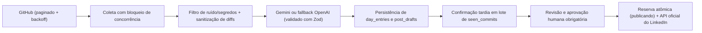

# Automação LinkedIn

**Versão base: 0.1.0 | Branch ativa: `melhoria/fundacao-testes` (Etapas 1, 2, 3 e 4 concluídas e verificadas localmente).**

Transforma atividades de desenvolvimento em rascunhos para revisão humana. Este repositório registra a evolução estruturada de um case de automação com IA com contratos tipados, validação em tempo de execução, proteção criptográfica e OAuth autenticado, integridade transacional, observabilidade estruturada sem segredos, pipeline de CI e testes ponta a ponta (Playwright).

## Objetivo

Aprender e demonstrar engenharia de software aplicada à IA: contratos tipados, testes de comportamento, recuperação de falhas, segurança, observabilidade e aprovação humana obrigatória. LangGraph (Etapa 5) será considerado somente após revisão e decisão explícita sobre a base estabilizada das Etapas 1 a 4.

## Recursos presentes e verificados no código

- Autenticação com Supabase e conexão OAuth com GitHub protegida por `state` assinado via `HMAC-SHA256` com expiração e vínculo ao usuário autenticado.
- Consulta paginada de repositórios, commits e diffs; filtro puro de arquivos por fronteira de segmento (`src/lib/commit-file-filter.ts`), sanitização de segredos em diffs (`src/lib/secret-sanitizer.ts`), backoff exponencial em leituras idempotentes e bloqueio contra coletas concorrentes.
- Anotações manuais e importação de texto.
- Geração e refinamento de rascunhos com Gemini (`x-goog-api-key`, timeout explícito via `AbortSignal.timeout`) e fallback automático para OpenAI, validados por schemas Zod em tempo de execução.
- Edição, aprovação humana obrigatória e publicação pela API oficial do LinkedIn com credencial individual por usuário, reserva atômica (`aprovado` → `publicando`) e reconciliação idempotente.
- Histórico de coletas e publicações, preferências com validação estrita de fusos IANA (`src/lib/timezone.ts`), observabilidade JSON estruturada sem segredos (`src/lib/observability.server.ts`) e temas claro/escuro.

Não há automação de navegador para publicar no LinkedIn. Toda publicação exige revisão e confirmação humana explícita.

## Fluxo atual (pós-Etapas 1 a 4)



## Tecnologias e organização

TypeScript, React, TanStack Start, Vite, Tailwind, Supabase/PostgreSQL, Zod, Vitest, Playwright e chamadas HTTP às APIs GitHub, LinkedIn e LLMs. As versões efetivas das dependências estão em `package-lock.json`.

| Diretório | Responsabilidade |
| --- | --- |
| `src/routes/` | Telas e endpoint de coleta agendada |
| `src/lib/` | Coleta, filtro, sanitização, IA, prompts, fuso IANA, cron, observabilidade, credenciais e publicação |
| `src/integrations/supabase/` | Clientes, autenticação e tipos do banco |
| `src/components/` | Componentes compartilhados |
| `tests/unit/` | Testes unitários de filtro, prompts, segurança, integridade, concorrência, cron, observabilidade e compatibilidade WebSocket |
| `tests/integration/` | Testes de integração da camada de IA com HTTP simulado |
| `tests/e2e/` | Testes ponta a ponta (Playwright) com servidor local de serviços simulados |
| `supabase/migrations/` | Estrutura e políticas declaradas do banco |
| `docs/` | Planejamento, relatórios de verificação por etapa e auditorias |

Interface e documentação próprias usam português. Identificadores técnicos, tabelas, contratos de APIs e arquivos gerados preservam os nomes existentes.

## Execução local

1. Instale uma versão de Node compatível com os `engines` das dependências travadas (recomendado Node.js 22 LTS ou superior; compatibilidade com Node.js 20 assegurada por `src/lib/websocket-compat.ts`).
2. Execute `npm ci`.
3. Copie `.env.example` para `.env` e preencha os valores localmente. Nunca envie esse arquivo ao Git.
4. Configure um projeto Supabase de desenvolvimento e aplique as migrações com revisão; a aplicação não provisiona o banco ao iniciar.
5. Configure as URLs de redirecionamento e os provedores utilizados. Na visualização local padrão, a origem é `http://localhost:5173` e o retorno GitHub é `/oauth/github/return`.
6. Execute `npm run dev` e use o endereço informado no terminal.

### Configuração e segredos

- `SUPABASE_URL`, `SUPABASE_PUBLISHABLE_KEY` e suas variantes `VITE_` são configurações do cliente/servidor.
- `SUPABASE_SERVICE_ROLE_KEY`, credenciais OAuth, chaves de IA e `ENCRYPTION_SECRET` pertencem exclusivamente ao servidor.
- Nunca coloque segredos em variáveis `VITE_`: elas podem integrar o pacote do navegador.
- `ENCRYPTION_SECRET` é **obrigatória** e deve conter exatamente 32 bytes codificados em base64 (não existe chave fixa de fallback).
- Os modelos padrão são `gemini-3.8-flash` (sobrescrevível via `GEMINI_MODEL`, ex.: `gemini-3.5-flash-lite`) e `gpt-4o-mini` (via `OPENAI_MODEL`); o tempo limite é configurável por `AI_TIMEOUT_MS` (padrão `30000`).
- Cada usuário utiliza exclusivamente sua própria credencial do LinkedIn armazenada criptografada em `app_user_connections` (não há token global compartilhado).
- `.env.example` contém somente exemplos. Ambientes, chaves privadas, builds e artefatos locais permanecem fora do Git.

## Verificações

```sh
npm test
npm run test:e2e
npm run typecheck
npm run lint
npm run build
```

## Progresso e Relatórios Verificados na Branch (`melhoria/fundacao-testes`)

### Etapa 1 — Fundação de Qualidade (Concluída e Verificada)
Registro detalhado em [docs/VERIFICACAO_ETAPA1.md](docs/VERIFICACAO_ETAPA1.md).

- **Framework de testes:** Vitest `4.1.12` (validado via Context7) em `vitest.config.ts` isolado dos plugins SSR, com scripts `test`, `test:watch` e `typecheck`.
- **Extração e correção do filtro (`F01`):** `deveIncluirArquivo` extraído para módulo puro (`src/lib/commit-file-filter.ts`), ancorado por fronteira de segmento (`(^|\/)build\/`, `(^|\/)dist\/`, lockfiles), normalizando `\` e rejeitando entradas vazias.
- **Integridade de persistência (`D03` — terminais da coleta):** Restaurada a checagem de erro de banco nos 4 caminhos terminais de `collectForUser` (autenticação, zero commits, erro na IA e sucesso) e na atualização de `since_at`, coberta por testes de regressão em `tests/unit/collect-persistence.test.ts`.
- **Regularização do Lint (`Q01`):** Corrigidos `prefer-const` (`src/routes/fontes.tsx`), aviso de `useEffect` (`src/routes/configuracoes.tsx`) e 492 erros de formatação Prettier sem desativar nenhuma regra do ESLint.

### Etapa 2 — Camada de IA Confiável (Concluída e Verificada)
Registro detalhado em [docs/VERIFICACAO_ETAPA2.md](docs/VERIFICACAO_ETAPA2.md).

- **Schemas em execução (`IA01`):** Validação Zod de entrada e saída (`summary`: 10–1.500 chars; `content`: 20–3.000 chars) em `src/lib/ai.server.ts`, rejeitando JSON inválido ou respostas vazias antes do banco/UI.
- **Resiliência e segurança (`IA02`):** Timeout explícito via `AbortSignal.timeout` (padrão 30s / `AI_TIMEOUT_MS`), chave do Gemini movida da URL para o cabeçalho `x-goog-api-key`, modelo padrão atualizado (`gemini-3.8-flash`) e fallback automático **Gemini → OpenAI** testado em `tests/integration/ai.server.test.ts` (sem cobrança de APIs).
- **Prompts e tons (`IA03` e `T01`):** Módulo puro `src/lib/prompts.ts` separando o roadmap interno dos prompts de post, aplicando o tom configurado pelo usuário na coleta automática e alinhando `TomDeVoz` (`profissional | narrativo | tecnico`).

### Etapa 3 — Automação, Segurança, Integridade, Observabilidade e CI (Concluída e Verificada)
Registros detalhados em [docs/VERIFICACAO_ETAPA3_1.md](docs/VERIFICACAO_ETAPA3_1.md) e [docs/VERIFICACAO_ETAPA3_COMPLETA.md](docs/VERIFICACAO_ETAPA3_COMPLETA.md).

- **Subetapa 3.1 — Segurança e Isolamento (`S01`, `S02`, `S03`, `S04`, `U02`):**
  - `ENCRYPTION_SECRET` obrigatória de 32 bytes em base64 (`src/lib/connectionKeyCrypto.server.ts`).
  - OAuth GitHub com `state` assinado via `HMAC-SHA256`, comparação em tempo constante (`timingSafeEqual`), TTL de 10 minutos e vínculo ao `userId` (`src/lib/oauthState.server.ts`).
  - Credencial LinkedIn estritamente individual por usuário (`src/lib/linkedin.server.ts`), sem fallback de token global.
  - Bloqueio de arquivos sensíveis (`.env*`, `.pem`, `.key`, `id_rsa`, `credentials.json`) e mascaramento de segredos em diffs antes do envio à IA (`src/lib/secret-sanitizer.ts`).
  - Filtros `.eq("user_id", userId)` e chaves de cache (`queryKey`) isoladas por `userId`.
- **Subetapa 3.2 — Integridade de Dados, Paginação e Concorrência (`D01`, `D02`, `P01`):**
  - Gravação de `seen_commits` em lote **somente após** a confirmação de `day_entries` e `post_drafts` (`D01`).
  - Paginação de repositórios e commits ordenados do mais antigo ao mais recente, preservando `until_at = desdeQuando` quando `max_commits_per_day` trunca excedentes e bloqueando coletas concorrentes para o mesmo usuário (`D02`).
  - Reserva atômica de publicação (`aprovado` → `publicando`), reconciliação idempotente quando `linkedin_post_id` já existe, reversão segura apenas em erros 4xx anteriores à criação e retenção em `publicando` em falhas incertas (timeout / 5xx) (`P01`).
- **Subetapa 3.3 — Execução Confiável, Fusos IANA e Cron (`A01`, `A02`):**
  - Validação IANA real com `Intl.DateTimeFormat` (`src/lib/timezone.ts`), substituição de `America/Rio_de_Janeiro` por `America/Sao_Paulo` e validação Zod no servidor (`A02`).
  - Execução agendada (`src/lib/cron.server.ts`) com autenticação em tempo constante e avanço de `last_run_date` exclusivamente quando `result.status === "ok"` (`A01`), além de backoff exponencial limitado em leituras idempotentes do GitHub.
- **Subetapa 3.4 — Observabilidade Estruturada sem Segredos:**
  - Eventos operacionais em JSON de linha única (`src/lib/observability.server.ts`) com `runId`, `userId`, `status`, `duracaoMs`, contagens, `provedorIA`, `modeloIA` e `latenciaIAMs`, redigindo credenciais automaticamente.
- **Subetapa 3.5 — Pipeline de CI:**
  - Workflow `.github/workflows/ci.yml` em Node.js 22 LTS executando `npm ci`, `npm run lint`, `npm run typecheck`, `npm test`, `npm run build` e `npm run test:e2e` com upload de artefatos.

### Etapa 4 — Interface, Revisão Humana e Testes E2E com Playwright (Concluída e Verificada)
Registro detalhado em [docs/VERIFICACAO_ETAPA4.md](docs/VERIFICACAO_ETAPA4.md).

- **Suíte E2E isolada (`playwright.config.ts`, `tests/e2e/`):** Servidor local determinístico (`tests/e2e/helpers/mock-services-server.mjs`) simulando Supabase Auth/PostgREST com RLS, GitHub, Gemini e LinkedIn UGC API sem chamadas externas, sem cobrança e sem publicar em contas reais.
- **Cobertura ponta a ponta (`tests/e2e/fluxo-principal.spec.ts`):** Autenticação e proteção de rotas, coleta do GitHub, revisão/edição de rascunho com bloqueio do botão `"Publicar agora"` até aprovação humana explícita (`"Aprovar este texto"`), modal de confirmação (`alertdialog`), publicação simulada, consulta de status em `/publicacoes`, criação manual, refinamento iterativo com feedback, tratamento resiliente de falha HTTP 500 da IA, alternância de tema claro/escuro, navegação por `/coletas`, `/fontes` e `/configuracoes`, e isolamento total de dados na troca de usuário (`Ana` → `Bruno`).
- **Compatibilidade WebSocket em Node.js 20 (`src/lib/websocket-compat.ts`):** Correção de regressão detectada pelos testes E2E onde `@supabase/realtime-js` exigia `globalThis.WebSocket` ao instanciar `createClient` no servidor em Node.js 20.

### Evidências Consolidadas na Branch

| Verificação | Comando | Resultado Atual |
| --- | --- | --- |
| **Testes Unitários + Integração** | `npm test` | ✅ **56/56 passando** (8 arquivos em `tests/unit/` e `tests/integration/`) |
| **Testes Ponta a Ponta (Playwright)** | `npm run test:e2e` | ✅ **4/4 cenários completos passando** (Chromium + servidor simulado isolado) |
| **TypeScript Estrito** | `npm run typecheck` | ✅ **0 erros** |
| **ESLint + Prettier** | `npm run lint` | ✅ **0 erros** *(7 avisos padrão do shadcn/ui `react-refresh`)* |
| **Build de Produção** | `npm run build` | ✅ **Compilado** (cliente + servidor) |
| **Higiene de Diff** | `git diff --check` | ✅ **0 problemas** |

Os registros históricos da preparação inicial `0.1.0` permanecem preservados em [docs/VERIFICACAO_0.1.0.md](docs/VERIFICACAO_0.1.0.md) e [docs/AUDITORIAS_0.1.0.md](docs/AUDITORIAS_0.1.0.md).

## Acompanhamento de Problemas e Limitações (Desde a 0.1.0)

| ID | Prioridade | Problema observado na 0.1.0 | Status na branch `melhoria/fundacao-testes` |
| --- | --- | --- | --- |
| Q01 | Alta | Lint reprovado e ausência de testes | ✅ **Resolvido nas Etapas 1 e 4** (56 testes Vitest + 4 fluxos E2E Playwright + 0 erros de lint) |
| F01 | Média | Filtro rejeita `src/rebuild/app.ts` por substring; entrada vazia aceita | ✅ **Resolvido nas Etapas 1–2** (`commit-file-filter.ts` + testes) |
| IA01 | Alta | Saída da IA sem validação em execução; JSON inválido virava texto | ✅ **Resolvido na Etapa 2** (schemas Zod + `ErroCamadaIA`) |
| IA02 | Alta | Falha Gemini não aciona OpenAI; timeout explícito ausente | ✅ **Resolvido na Etapa 2** (`AbortSignal.timeout` + fallback) |
| IA03 | Média | Prompt inclui roadmap fixo e tom da coleta não orientava geração | ✅ **Resolvido na Etapa 2** (`src/lib/prompts.ts`) |
| T01 | Média | Tipos de domínio e contratos de tons divergiam | ✅ **Resolvido na Etapa 2** (`TomDeVoz` unificado) |
| S01 | Crítica para produção | Chave de criptografia fixa se o ambiente estiver incompleto | ✅ **Resolvido na Subetapa 3.1** (`ENCRYPTION_SECRET` 32B obrigatória) |
| S02 | Alta | OAuth GitHub não valida o `state` de retorno | ✅ **Resolvido na Subetapa 3.1** (`oauthState.server.ts` HMAC + TTL) |
| S03 | Alta | Token LinkedIn global pode ser usado por outro usuário | ✅ **Resolvido na Subetapa 3.1** (`obterTokenLinkedInDoUsuario` em `linkedin.server.ts`) |
| S04 | Alta | Filtro de ruído não é filtro de segredos | ✅ **Resolvido na Subetapa 3.1** (`secret-sanitizer.ts` + filtro `.env`/`.pem`) |
| U02 | Média | Cache de algumas consultas não inclui usuário | ✅ **Resolvido na Subetapa 3.1 + Etapa 4** (`userId` nas `queryKey`s, queries e teste E2E de troca de sessão) |
| D03 | Alta | Gravações e conclusão de execução ignoravam alguns erros | ✅ **Resolvido nas Etapas 1 e 3.1** (caminhos terminais, conexões e publicação verificados) |
| D01 | Alta | Commits marcados antes de salvar rascunho | ✅ **Resolvido na Subetapa 3.2** (confirmação tardia em lote de `seen_commits` pós-persistência) |
| D02 | Alta | Paginação limitada e marco temporal global podem deixar commits para trás | ✅ **Resolvido na Subetapa 3.2** (paginação, ordenação cronológica e preservação de `until_at` com excedentes) |
| P01 | Alta | Publicação sem reserva atômica; erro ao salvar resultado pode ser ignorado | ✅ **Resolvido na Subetapa 3.2** (reserva atômica `aprovado` → `publicando` e reconciliação idempotente) |
| A01 | Alta | Cron marca o dia mesmo após resultado de erro | ✅ **Resolvido na Subetapa 3.3** (`cron.server.ts` avança `last_run_date` apenas quando `status === "ok"`) |
| A02 | Alta | Fuso `America/Rio_de_Janeiro` inválido e cálculos de data inconsistentes | ✅ **Resolvido na Subetapa 3.3** (`timezone.ts` com validação IANA via `Intl.DateTimeFormat`) |
| U01 | Média | Preferências de notificação sem entrega implementada | ⏳ Evolução posterior de produto (fora do escopo das Etapas 1–4 conforme `roadmap.md`) |

## Roteiro e versionamento

Leia [roadmap.md](roadmap.md) e [CHANGELOG.md](CHANGELOG.md).
