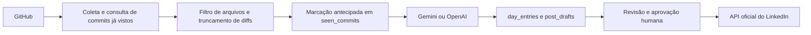

# Automação LinkedIn

**Versão base: 0.1.0 | Branch ativa: `melhoria/fundacao-testes` (Etapas 1, 2 e 3.1 verificadas localmente — etapas 3.2+ e 4 pendentes).**

Transforma atividades de desenvolvimento em rascunhos para revisão humana. Este repositório registra a evolução estruturada de um case de automação com IA. Não representa ainda uma versão pronta para produção até a conclusão das etapas de segurança, integridade operacional e testes E2E (Etapas 3 e 4).

## Objetivo

Aprender e demonstrar engenharia de software aplicada à IA: contratos tipados, testes de comportamento, recuperação de falhas, segurança, observabilidade e aprovação humana. LangGraph será considerado somente depois da estabilização e aprovação das etapas de qualidade.

## Recursos presentes no código

- Autenticação com Supabase e conexão OAuth com GitHub.
- Consulta de repositórios, commits e diffs; filtro de arquivos e acompanhamento da coleta.
- Anotações manuais e importação de texto.
- Geração e refinamento de rascunhos com Gemini ou OpenAI.
- Edição, aprovação e solicitação de publicação pela API oficial do LinkedIn.
- Histórico, preferências de coleta e temas claro/escuro.

A existência do código não comprova o funcionamento ponta a ponta. Não há automação de navegador para publicar no LinkedIn. A publicação exige revisão humana.

## Fluxo atual



A marcação antecipada é uma falha conhecida: se a IA ou a gravação falhar, uma tentativa posterior pode ignorar commits ainda sem rascunho.

## Tecnologias e organização

TypeScript, React, TanStack Start, Vite, Tailwind, Supabase/PostgreSQL e chamadas HTTP às APIs GitHub, LinkedIn e LLMs. As versões efetivas das dependências estão em `package-lock.json`.

| Diretório | Responsabilidade |
| --- | --- |
| `src/routes/` | Telas e endpoint de coleta |
| `src/lib/` | Coleta, IA, credenciais e publicação |
| `src/integrations/supabase/` | Clientes, autenticação e tipos do banco |
| `src/components/` | Componentes compartilhados |
| `supabase/migrations/` | Estrutura e políticas declaradas do banco |
| `docs/` | Planejamento e evidências |

Interface e documentação próprias usam português. Identificadores técnicos, tabelas, contratos de APIs e arquivos gerados preservam os nomes existentes. Comentários legados ainda podem conter inglês; a revisão não inclui renomear toda a base nem modificar código gerado.

## Execução local

1. Instale uma versão de Node compatível com os `engines` das dependências travadas.
2. Execute `npm ci`.
3. Copie `.env.example` para `.env` e preencha os valores localmente. Nunca envie esse arquivo ao Git.
4. Configure um projeto Supabase de desenvolvimento e aplique as migrações com revisão; a aplicação não provisiona o banco ao iniciar.
5. Configure as URLs de redirecionamento e os provedores utilizados. Na visualização atual, a origem local é `http://localhost:5173` e o retorno GitHub é `/oauth/github/return`.
6. Execute `npm run dev` e use o endereço informado no terminal.

Para visualizar a autenticação, as configurações Supabase precisam estar válidas. Para gerar rascunhos são necessárias credenciais de IA; para coletar, uma conexão GitHub. Não existe modo de demonstração com dados fictícios nesta versão.

### Configuração e segredos

- `SUPABASE_URL`, `SUPABASE_PUBLISHABLE_KEY` e suas variantes `VITE_` são configurações do cliente/servidor.
- `SUPABASE_SERVICE_ROLE_KEY`, credenciais OAuth, chaves de IA e `ENCRYPTION_SECRET` pertencem exclusivamente ao servidor.
- Nunca coloque segredos em variáveis `VITE_`: elas podem integrar o pacote do navegador.
- Gere sua própria chave de criptografia de 32 bytes em base64. Não dependa da chave fixa de fallback existente nesta versão.
- Os modelos padrão atuais são `gemini-3.8-flash` (sobrescrevível via `GEMINI_MODEL`, ex.: `gemini-3.5-flash-lite`) e `gpt-4o-mini` (via `OPENAI_MODEL`); o tempo limite é configurável por `AI_TIMEOUT_MS` (padrão `30000`).
- `LINKEDIN_ACCESS_TOKEN` é um fallback global legado, inadequado para uso multiusuário.
- A rota ativa do cron consulta `cron_secrets` no banco. O helper que lê `CRON_SECRET` não está conectado a ela. Não há agendador externo configurado neste repositório.
- `.env.example` contém somente exemplos. Ambientes, chaves privadas, builds e artefatos locais devem permanecer fora do Git.

## Verificações

```sh
npm test
npm run typecheck
npm run lint
npm run build
```

## Progresso e Relatórios Verificados na Branch (`melhoria/fundacao-testes`)

### Etapa 1 — Fundação de Qualidade (Concluída e Verificada)
Registro detalhado em [docs/VERIFICACAO_ETAPA1.md](docs/VERIFICACAO_ETAPA1.md).

- **Framework de testes:** Vitest `4.1.12` (validado via Context7 para Node 20.20.2 + Vite 8.1.5) em `vitest.config.ts` isolado dos plugins SSR, com scripts `test`, `test:watch` e `typecheck`.
- **Extração e correção do filtro (`F01`):** `deveIncluirArquivo` extraído para módulo puro (`src/lib/commit-file-filter.ts`), ancorado por fronteira de segmento (`(^|\/)build\/`, `(^|\/)dist\/`, lockfiles), normalizando `\` e rejeitando entradas vazias.
- **Integridade de persistência (`D03` — terminais da coleta):** Restaurada a checagem de erro de banco nos 4 caminhos terminais de `collectForUser` (autenticação, zero commits, erro na IA e sucesso) e na atualização de `since_at`, coberta por testes de regressão em `tests/unit/collect-persistence.test.ts`.
- **Regularização do Lint (`Q01`):** Corrigidos `prefer-const` (`src/routes/fontes.tsx`), aviso de `useEffect` (`src/routes/configuracoes.tsx`) e 492 erros de formatação Prettier sem desativar nenhuma regra do ESLint.

### Etapa 2 — Camada de IA Confiável (Concluída e Verificada)
Registro detalhado em [docs/VERIFICACAO_ETAPA2.md](docs/VERIFICACAO_ETAPA2.md).

- **Schemas em execução (`IA01`):** Validação Zod de entrada e saída (`summary`: 10–1.500 chars; `content`: 20–3.000 chars) em `src/lib/ai.server.ts`, rejeitando JSON inválido ou respostas vazias antes do banco/UI.
- **Resiliência e segurança (`IA02`):** Timeout explícito via `AbortSignal.timeout` (padrão 30s / `AI_TIMEOUT_MS`), chave do Gemini movida da URL para o cabeçalho `x-goog-api-key`, modelo padrão atualizado (`gemini-3.8-flash`) e fallback automático **Gemini → OpenAI** testado em `tests/integration/ai.server.test.ts` (sem cobrança de APIs).
- **Prompts e tons (`IA03` e `T01`):** Novo módulo puro `src/lib/prompts.ts` separando o roadmap interno dos prompts de post, aplicando o tom configurado pelo usuário na coleta automática e alinhando `TomDeVoz` (`profissional | narrativo | tecnico`).

### Subetapa 3.1 — Segurança Crítica e Isolamento (Concluída e Verificada)
Registro detalhado em [docs/VERIFICACAO_ETAPA3_1.md](docs/VERIFICACAO_ETAPA3_1.md).

- **Criptografia obrigatória (`S01`):** Removida a chave fixa de fallback em `src/lib/connectionKeyCrypto.server.ts`; `ENCRYPTION_SECRET` (base64 de exatos 32 bytes) agora é validada obrigatoriamente.
- **OAuth com `state` autenticado (`S02`):** Novo módulo `src/lib/oauthState.server.ts` com assinatura `HMAC-SHA256`, comparação em tempo constante (`timingSafeEqual`), expiração de 10 minutos e vínculo estrito ao `userId` autenticado.
- **Credencial LinkedIn individual (`S03`):** Removido o fallback global `LINKEDIN_ACCESS_TOKEN` em `src/lib/linkedin.functions.ts`; cada usuário utiliza exclusivamente sua própria conexão em `app_user_connections`.
- **Prevenção de vazamento de segredos (`S04`):** Bloqueio de `.env*` reais, `.pem`, `.key`, `id_rsa`, `id_ed25519` e `credentials.json` no filtro de arquivos + mascaramento de tokens, chaves privadas e senhas em URLs via `src/lib/secret-sanitizer.ts` antes do envio à IA.
- **Isolamento entre usuários (`U02`):** Filtros `.eq("user_id", userId)` explícitos e inclusão de `userId` nas `queryKey`s de cache em `index.tsx`, `publicacoes.tsx`, `rascunho.$id.tsx`, `drafts.functions.ts` e `linkedin.functions.ts`.

### Evidências Consolidadas na Branch

| Verificação | Comando | Resultado Atual |
| --- | --- | --- |
| **Testes Unitários + Integração** | `npm test` | ✅ **39/39 passando** (5 arquivos em `tests/unit/` e `tests/integration/`) |
| **TypeScript Estrito** | `npm run typecheck` | ✅ **0 erros** |
| **ESLint + Prettier** | `npm run lint` | ✅ **0 erros** *(7 avisos padrão do shadcn/ui `react-refresh`)* |
| **Build de Produção** | `npm run build` | ✅ **Compilado** (cliente + servidor) |
| **Higiene de Diff** | `git diff --check` | ✅ **0 problemas** |

Os registros históricos da preparação inicial `0.1.0` permanecem preservados em [docs/VERIFICACAO_0.1.0.md](docs/VERIFICACAO_0.1.0.md) e [docs/AUDITORIAS_0.1.0.md](docs/AUDITORIAS_0.1.0.md). Build e testes unitários/integrados aprovados ainda não substituem a conclusão das subetapas 3.2–3.5 e dos testes E2E da Etapa 4.

## Erros e limitações conhecidos (Acompanhamento desde a 0.1.0)

| ID | Prioridade | Problema observado | Status na branch / Próxima etapa |
| --- | --- | --- | --- |
| Q01 | Alta | Lint reprovado e ausência de testes | ✅ **Resolvido na Etapa 1** (Vitest + 0 erros de lint) |
| F01 | Média | Filtro rejeita `src/rebuild/app.ts` por substring; entrada vazia aceita | ✅ **Resolvido nas Etapas 1–2** (`commit-file-filter.ts` + testes) |
| IA01 | Alta | Saída da IA sem validação em execução; JSON inválido virava texto | ✅ **Resolvido na Etapa 2** (schemas Zod + `ErroCamadaIA`) |
| IA02 | Alta | Falha Gemini não aciona OpenAI; timeout explícito ausente | ✅ **Resolvido na Etapa 2** (`AbortSignal.timeout` + fallback) |
| IA03 | Média | Prompt inclui roadmap fixo e tom da coleta não orientava geração | ✅ **Resolvido na Etapa 2** (`src/lib/prompts.ts`) |
| T01 | Média | Tipos de domínio e contratos de tons divergiam | ✅ **Resolvido na Etapa 2** (`TomDeVoz` unificado) |
| S01 | Crítica para produção | Chave de criptografia fixa se o ambiente estiver incompleto | ✅ **Resolvido na Subetapa 3.1** (`ENCRYPTION_SECRET` 32B obrigatória) |
| S02 | Alta | OAuth GitHub não valida o `state` de retorno | ✅ **Resolvido na Subetapa 3.1** (`oauthState.server.ts` HMAC + TTL) |
| S03 | Alta | Token LinkedIn global pode ser usado por outro usuário | ✅ **Resolvido na Subetapa 3.1** (`obterTokenLinkedInDoUsuario`) |
| S04 | Alta | Filtro de ruído não é filtro de segredos | ✅ **Resolvido na Subetapa 3.1** (`secret-sanitizer.ts` + filtro `.env`/`.pem`) |
| U02 | Média | Cache de algumas consultas não inclui usuário | ✅ **Resolvido na Subetapa 3.1** (`userId` nas `queryKey`s e queries) |
| D03 | Alta | Gravações e conclusão de execução ignoravam alguns erros | ✅ **Resolvido nas Etapas 1 e 3.1** (caminhos terminais, conexões e publicação verificados) |
| D01 | Alta | Commits marcados antes de salvar rascunho | ⏳ Subetapa 3.2: confirmação pós-persistência e recuperação |
| D02 | Alta | Paginação limitada e marco temporal global podem deixar commits para trás | ⏳ Subetapa 3.2: paginação e pendências por repositório |
| P01 | Alta | Publicação sem reserva atômica; erro ao salvar resultado pode ser ignorado | ⏳ Subetapa 3.2: concorrência, tentativas e reconciliação |
| A01 | Alta | Cron marca o dia mesmo após resultado de erro | ⏳ Subetapa 3.3: separar tentativa de sucesso e impedir sobreposição |
| A02 | Alta | Fuso `America/Rio_de_Janeiro` inválido e cálculos de data inconsistentes | ⏳ Subetapa 3.3: validação IANA e datas determinísticas |
| U01 | Média | Preferências de notificação sem entrega implementada | ⏳ Evolução posterior com testes |

A auditoria anterior apontou também um alerta alto em Zod. Isso deve ser revalidado antes de atualizar dependências; não foi executada atualização automática nesta preparação.

## Roteiro e versionamento

Leia [roadmap.md](roadmap.md) e [CHANGELOG.md](CHANGELOG.md). Cada etapa termina com evidências e aprovação humana. O marco `v0.1.0` só deve ser criado e enviado após a liberação do gate de publicação; a branch proposta para o trabalho seguinte é `melhoria/fundacao-testes`.

A documentação de falhas não equivale à liberação do gate. Enquanto houver pendências obrigatórias de testes ou auditoria, a preparação permanece local.
