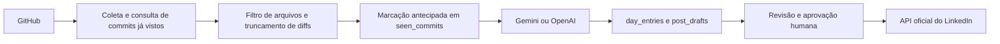

# Automação LinkedIn

**Versão preparada: 0.1.0 — experimental, anterior à fundação de testes.**

Transforma atividades de desenvolvimento em rascunhos para revisão humana. Este repositório registra o ponto de partida de um case de automação com IA. Não representa uma versão pronta para produção. A preparação local não significa que a versão já foi enviada ao GitHub; consulte o relatório de liberação.

## Objetivo

Aprender e demonstrar engenharia de software aplicada à IA: contratos tipados, testes de comportamento, recuperação de falhas, segurança, observabilidade e aprovação humana. LangGraph será considerado somente depois da estabilização e aprovação das etapas de qualidade.

## Recursos presentes no código

- Autenticação com Supabase e conexão OAuth com GitHub.
- Consulta de repositórios, commits e diffs; filtro de arquivos e acompanhamento da coleta.
- Anotações manuais e importação de texto.
- Geração e refinamento de rascunhos com Gemini ou OpenAI.
- Edição, aprovação e solicitação de publicação pela API oficial do LinkedIn.
- Histórico, preferências de coleta e temas claro/escuro.

A existência do código não comprova o funcionamento ponta a ponta. Não há automação de navegador para publicar no LinkedIn. A publicação exige revisão humana.

## Fluxo atual



A marcação antecipada é uma falha conhecida: se a IA ou a gravação falhar, uma tentativa posterior pode ignorar commits ainda sem rascunho.

## Tecnologias e organização

TypeScript, React, TanStack Start, Vite, Tailwind, Supabase/PostgreSQL e chamadas HTTP às APIs GitHub, LinkedIn e LLMs. As versões efetivas das dependências estão em `package-lock.json`.

| Diretório | Responsabilidade |
| --- | --- |
| `src/routes/` | Telas e endpoint de coleta |
| `src/lib/` | Coleta, IA, credenciais e publicação |
| `src/integrations/supabase/` | Clientes, autenticação e tipos do banco |
| `src/components/` | Componentes compartilhados |
| `supabase/migrations/` | Estrutura e políticas declaradas do banco |
| `docs/` | Planejamento e evidências |

Interface e documentação próprias usam português. Identificadores técnicos, tabelas, contratos de APIs e arquivos gerados preservam os nomes existentes. Comentários legados ainda podem conter inglês; a revisão não inclui renomear toda a base nem modificar código gerado.

## Execução local

1. Instale uma versão de Node compatível com os `engines` das dependências travadas.
2. Execute `npm ci`.
3. Copie `.env.example` para `.env` e preencha os valores localmente. Nunca envie esse arquivo ao Git.
4. Configure um projeto Supabase de desenvolvimento e aplique as migrações com revisão; a aplicação não provisiona o banco ao iniciar.
5. Configure as URLs de redirecionamento e os provedores utilizados. Na visualização atual, a origem local é `http://localhost:5173` e o retorno GitHub é `/oauth/github/return`.
6. Execute `npm run dev` e use o endereço informado no terminal.

Para visualizar a autenticação, as configurações Supabase precisam estar válidas. Para gerar rascunhos são necessárias credenciais de IA; para coletar, uma conexão GitHub. Não existe modo de demonstração com dados fictícios nesta versão.

### Configuração e segredos

- `SUPABASE_URL`, `SUPABASE_PUBLISHABLE_KEY` e suas variantes `VITE_` são configurações do cliente/servidor.
- `SUPABASE_SERVICE_ROLE_KEY`, credenciais OAuth, chaves de IA e `ENCRYPTION_SECRET` pertencem exclusivamente ao servidor.
- Nunca coloque segredos em variáveis `VITE_`: elas podem integrar o pacote do navegador.
- Gere sua própria chave de criptografia de 32 bytes em base64. Não dependa da chave fixa de fallback existente nesta versão.
- Escolha um modelo disponível por `GEMINI_MODEL` ou `OPENAI_MODEL`; o padrão Gemini no código precisa de revisão.
- `LINKEDIN_ACCESS_TOKEN` é um fallback global legado, inadequado para uso multiusuário.
- A rota ativa do cron consulta `cron_secrets` no banco. O helper que lê `CRON_SECRET` não está conectado a ela. Não há agendador externo configurado neste repositório.
- `.env.example` contém somente exemplos. Ambientes, chaves privadas, builds e artefatos locais devem permanecer fora do Git.

## Verificações

```sh
npm run lint
./node_modules/.bin/tsc --noEmit --incremental false
npm run build
```

Ainda não há framework de testes, pasta `tests/`, script `test` ou script `typecheck`. Nenhuma suíte automatizada pode ser declarada aprovada.

Os resultados desta preparação estão em [docs/VERIFICACAO_0.1.0.md](docs/VERIFICACAO_0.1.0.md). Falhas de lint não devem ser ocultadas ou resolvidas desativando regras. Build aprovado não comprova segurança nem funcionamento das APIs.

## Erros e limitações conhecidos da 0.1.0

| ID | Prioridade | Problema observado | Correção planejada |
| --- | --- | --- | --- |
| Q01 | Alta | Lint reprovado e ausência de testes | Etapa 1: baseline, Vitest e testes reais |
| IA01 | Alta | Saída da IA sem validação em execução; JSON inválido pode virar texto | Etapa 2: schemas, erros explícitos e regressões |
| IA02 | Alta | Falha Gemini não aciona OpenAI; timeout explícito ausente | Etapa 2: política de falhas, timeout e fallback testado |
| IA03 | Média | Prompt inclui roadmap fixo e o tom da coleta não orienta a geração | Etapa 2: separar planejamento e conteúdo, aplicar tom |
| D01 | Alta | Commits marcados antes de salvar rascunho | Etapa 3: confirmação transacional e recuperação |
| D02 | Alta | Paginação limitada e marco temporal global podem deixar commits para trás | Etapa 3: preservar pendências por repositório |
| D03 | Alta | Gravações e conclusão de execução ignoram alguns erros | Etapa 3: verificar todos os resultados de persistência |
| P01 | Alta | Publicação sem reserva atômica; erro ao salvar resultado pode ser ignorado | Etapa 3: concorrência, tentativas e reconciliação |
| S01 | Crítica para produção | Chave de criptografia fixa se o ambiente estiver incompleto | Correção de segurança antes de produção |
| S02 | Alta | OAuth GitHub não valida o state de retorno | Correção de segurança com teste de regressão |
| S03 | Alta | Token LinkedIn global pode ser usado por outro usuário | OAuth individual e remoção do fallback multiusuário |
| S04 | Alta | Filtro de ruído não é filtro de segredos | Sanitização e seleção de repositórios antes de enviar diffs |
| A01 | Alta | Cron marca o dia mesmo após resultado de erro | Etapa 3: separar tentativa de sucesso e impedir sobreposição |
| A02 | Alta | Fuso America/Rio_de_Janeiro inválido e cálculos de data inconsistentes | Etapa 3: validação e datas determinísticas |
| U01 | Média | Preferências de notificação sem entrega implementada | Implementação posterior com testes |
| U02 | Média | Cache de algumas consultas não inclui usuário | Etapas 3–4: isolamento de sessão e E2E |
| F01 | Média | Filtro rejeita src/rebuild/app.ts por substring; entrada vazia é aceita | Etapa 1: testes e limites de segmentos |
| T01 | Média | Tipos de domínio e contratos de tons ainda divergem | Ajustar contratos conforme uso real |

A auditoria anterior apontou também um alerta alto em Zod. Isso deve ser revalidado antes de atualizar dependências; não foi executada atualização automática nesta preparação.

## Roteiro e versionamento

Leia [roadmap.md](roadmap.md) e [CHANGELOG.md](CHANGELOG.md). Cada etapa termina com evidências e aprovação humana. O marco `v0.1.0` só deve ser criado e enviado após a liberação do gate de publicação; a branch proposta para o trabalho seguinte é `melhoria/fundacao-testes`.

A documentação de falhas não equivale à liberação do gate. Enquanto houver pendências obrigatórias de testes ou auditoria, a preparação permanece local.
