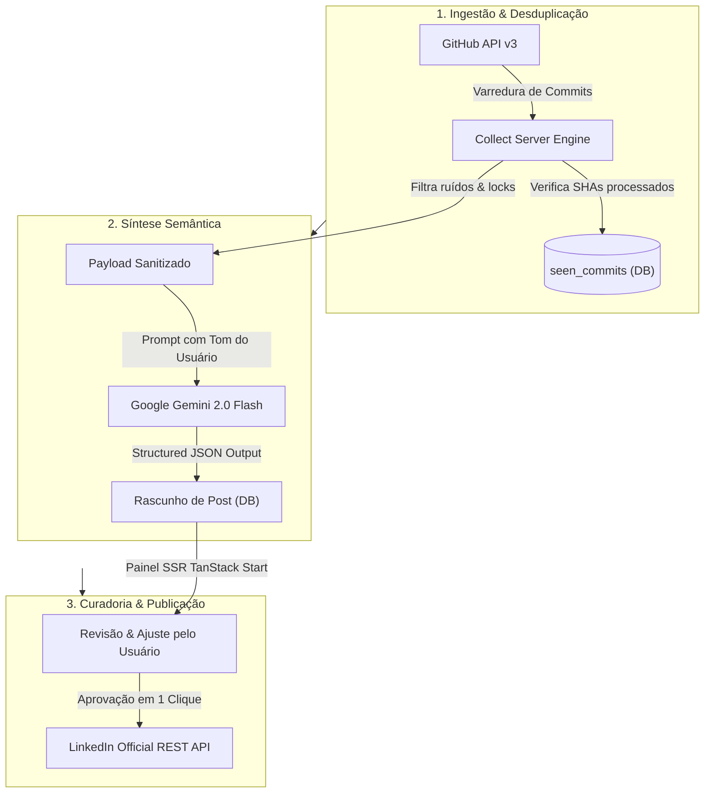
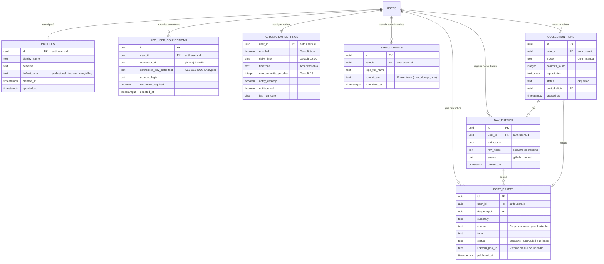
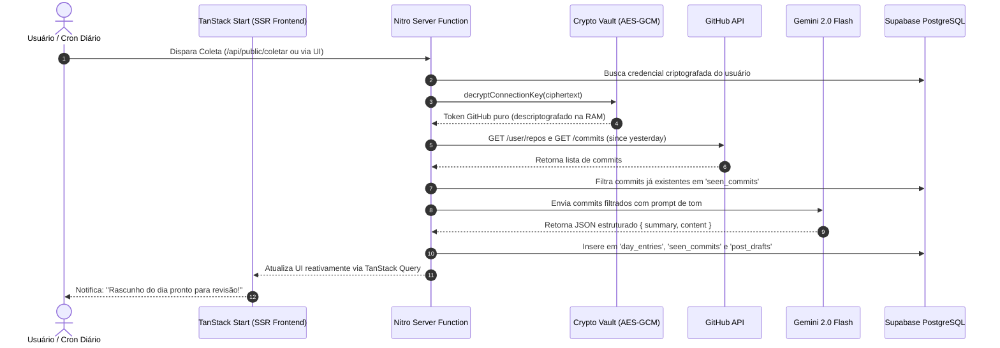

# 🚀 Automação LinkedIn (DevLog to Social Engine)

<div align="center">


**Transforme seus commits diários do GitHub em publicações de alto engajamento no LinkedIn automaticamente, sem atrito e sem interromper seu fluxo de desenvolvimento.**

[Visão Geral](#-visão-geral) • [O Motor do Produto](#-o-motor-do-produto-core-engine) • [Modelagem de Dados (DER)](#-modelagem-de-dados-der--erd) • [Arquitetura & Fluxo](#-arquitetura--fluxo-de-dados) • [Deep Dive no Código](#-deep-dive-no-código-partes-críticas) • [Como Rodar](#-como-rodar-o-projeto)

</div>

---

## 📌 Visão Geral

Desenvolvedores produzem código todos os dias, mas raramente constroem presença digital ("Building in Public") pela fricção de parar o trabalho para redigir posts sobre o que foi feito. 

A **Automação LinkedIn** resolve essa dor:
1. Conecta-se de forma segura à sua conta do **GitHub**.
2. Rastreia seus commits diários e filtra apenas o código de valor real (ignorando `lockfiles`, builds e assets pesados).
3. Utiliza **Inteligência Artificial (Google Gemini 2.0 Flash / OpenAI)** com engenharia de prompts refinada para traduzir diffs técnicos em narrativas claras e atraentes.
4. Gera rascunhos com múltiplos tons de voz (*profissional*, *storytelling*, *técnico*) prontos para aprovação e publicação direta na API oficial do **LinkedIn**.

---

## ⚙️ O Motor do Produto (Core Engine)

O ciclo de funcionamento contínuo do sistema baseia-se em 4 etapas sincronizadas:



---

## 🗄️ Modelagem de Dados (DER / ERD)

O esquema relacional é implementado no **PostgreSQL (Supabase)** com isolamento multi-tenant estrito garantido por **Row-Level Security (RLS)** em todas as tabelas:



---

## 🏛️ Arquitetura & Fluxo de Dados

A aplicação utiliza arquitetura moderna com **Server Functions** do TanStack Start e isolamento de segredos no servidor:



---

## 🔍 Deep Dive no Código (Partes Críticas)

### 1. Criptografia Segura de Tokens OAuth (`AES-256-GCM`)
Tokens do GitHub e LinkedIn nunca são salvos em texto puro no banco. O servidor utiliza o padrão bancário **AES-256-GCM com Initialization Vector (IV) aleatório de 12 bytes e Auth Tag de integridade**:

```typescript
// src/lib/connectionKeyCrypto.server.ts
import { createCipheriv, createDecipheriv, randomBytes } from "node:crypto";

export function encryptConnectionKey(plaintext: string): string {
  const iv = randomBytes(12);
  const cipher = createCipheriv("aes-256-gcm", getMasterKey(), iv);
  const ct = Buffer.concat([cipher.update(plaintext, "utf8"), cipher.final()]);
  // Concatena IV + Auth Tag + Ciphertext em Base64
  return Buffer.concat([iv, cipher.getAuthTag(), ct]).toString("base64");
}

export function decryptConnectionKey(stored: string): string {
  const buf = Buffer.from(stored, "base64");
  const iv = buf.subarray(0, 12);
  const tag = buf.subarray(12, 28);
  const ct = buf.subarray(28);
  const decipher = createDecipheriv("aes-256-gcm", getMasterKey(), iv);
  decipher.setAuthTag(tag);
  return Buffer.concat([decipher.update(ct), decipher.final()]).toString("utf8");
}
```

---

### 2. Filtro Anti-Ruído e Ingestão de Commits
Commits em lockfiles ou pastas de dependências não representam trabalho autoral do desenvolvedor. O `collect.server.ts` aplica um sanitizador por Expressões Regulares antes de alimentar a IA:

```typescript
// src/lib/collect.server.ts
const IGNORED_PATHS = [
  /package-lock\.json$/,
  /yarn\.lock$/,
  /pnpm-lock\.yaml$/,
  /bun\.lockb$/,
  /dist\//,
  /build\//,
  /node_modules\//,
  /\.png$/, /\.jpg$/, /\.svg$/
];

// Garante que a IA receba apenas o delta de código relevante, 
// economizando tokens e gerando posts com alto contexto técnico.
```

---

### 3. Síntese Inteligente com Google Gemini Estruturado
A chamada para o Gemini utiliza **Structured Outputs (`response_schema`)** nativo da API v1beta do Google, garantindo que o retorno seja sempre um JSON válido sem falhas de parse:

```typescript
// src/lib/ai.server.ts
const res = await fetch(geminiUrl, {
  method: "POST",
  headers: { "Content-Type": "application/json" },
  body: JSON.stringify({
    system_instruction: { parts: [{ text: systemPrompt }] },
    contents: [{ parts: [{ text: userContent }] }],
    generationConfig: {
      response_mime_type: "application/json",
      response_schema: {
        type: "OBJECT",
        properties: {
          summary: { type: "STRING" },
          content: { type: "STRING" }
        },
        required: ["summary", "content"]
      }
    }
  })
});
```

---

## 🛠️ Stack Tecnológica

| Camada | Tecnologia | Propósito |
| :--- | :--- | :--- |
| **Framework Fullstack** | **TanStack Start (Vite + Nitro)** | Renderização SSR rápida, rotas baseadas em arquivos e Server Functions seguras. |
| **UI & Estilização** | **Tailwind CSS v4 + Radix UI** | Interface fluida, acessível e suporte nativo a temas Dark/Light. |
| **Gerenciamento de Estado** | **TanStack Query v5** | Cache e sincronização reativa dos dados de coletas e rascunhos. |
| **Banco de Dados & Auth** | **Supabase (PostgreSQL)** | Autenticação Google/GitHub OAuth, RLS e triggers de atualização. |
| **Inteligência Artificial** | **Google Gemini 2.0 Flash** | Geração ultrarrápida de posts com saída em JSON estruturado (com fallback OpenAI). |
| **Segurança** | **Node.js Crypto (AES-256-GCM)** | Criptografia simétrica autenticada para tokens sensíveis de OAuth. |

---

## 🚀 Como Rodar o Projeto

### Pré-requisitos
* **Node.js 20+** ou **Bun** instalado.
* Um projeto no **Supabase** (banco PostgreSQL).
* Uma chave de API do **Google AI Studio** (`GEMINI_API_KEY`).

### Passo a Passo

1. **Clone o repositório:**
   ```bash
   git clone https://github.com/SEU_USUARIO/automacao-linkedinsk.git
   cd automacao-linkedinsk
   ```

2. **Instale as dependências:**
   ```bash
   npm install
   ```

3. **Configure as Variáveis de Ambiente:**
   Copie o arquivo de exemplo:
   ```bash
   cp .env.example .env
   ```
   Preencha as chaves:
   * `VITE_SUPABASE_URL` e `VITE_SUPABASE_ANON_KEY`
   * `SUPABASE_SERVICE_ROLE_KEY` (usada exclusivamente no backend pelo Nitro)
   * `GEMINI_API_KEY` (gratuita via [Google AI Studio](https://aistudio.google.com/))
   * `ENCRYPTION_SECRET` (chave de 32 bytes em base64 para o cofre AES-GCM)

4. **Inicie o servidor de desenvolvimento:**
   ```bash
   npm run dev
   ```
   O aplicativo estará disponível em: `http://localhost:3000`

---

## 🗺️ Roadmap de Evolução

- [x] Desacoplamento de plataformas proprietárias e arquitetura TanStack Start limpa.
- [x] Ingestão de commits diretamente pela API oficial do GitHub.
- [x] Criptografia de ponta a ponta para credenciais OAuth com AES-256-GCM.
- [x] Integração nativa com Google Gemini 2.0 Flash e fallback OpenAI.
- [ ] Envio de e-mail diário com rascunhos prontos (via Resend).
- [ ] Geração automática de carrosséis em PDF para o LinkedIn baseados no post.
- [ ] Ajuste fino do estilo de escrita por aprendizado com posts anteriores do usuário.

---

<div align="center">
Desenvolvido com foco em alta engenharia de software e privacidade de dados.
</div>
